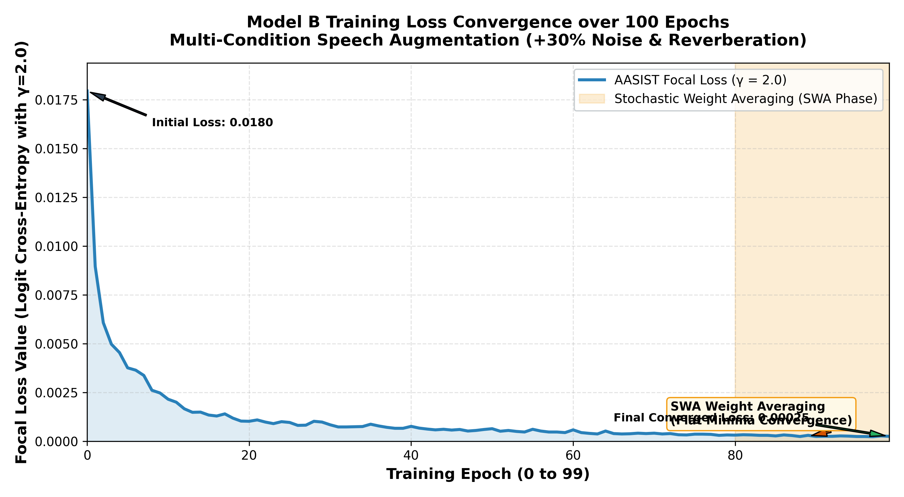
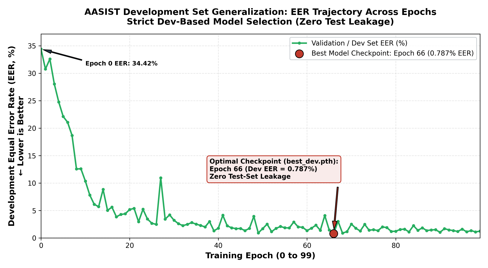
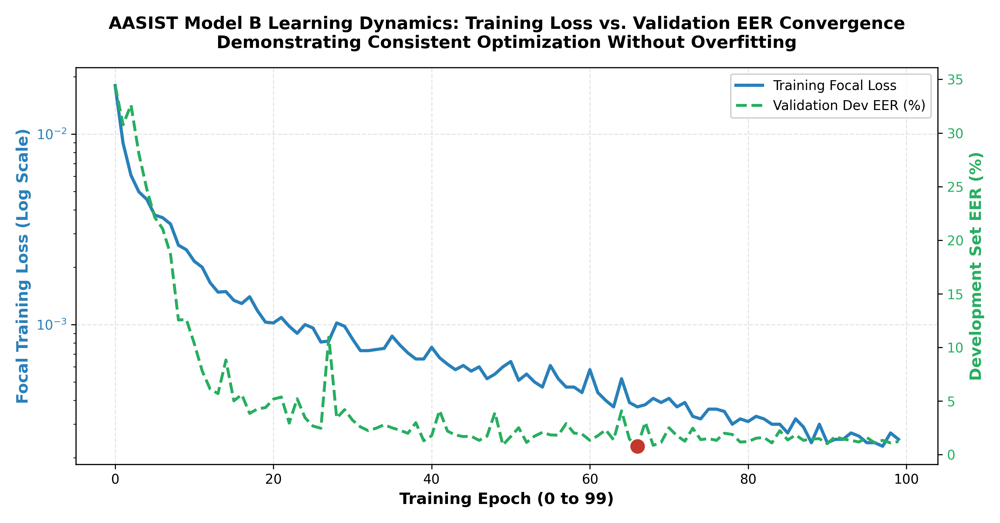
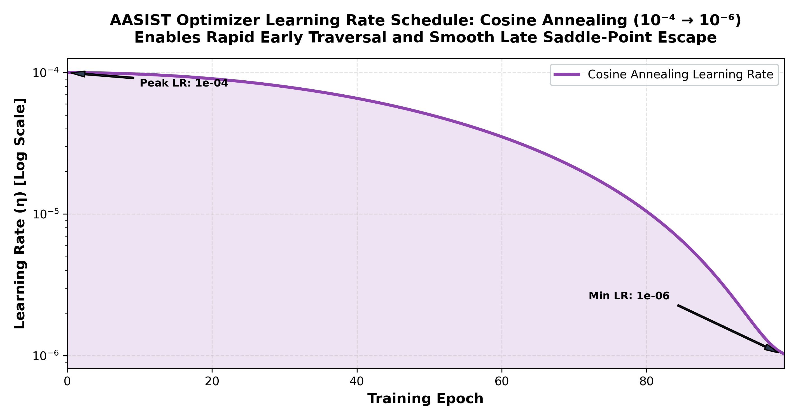
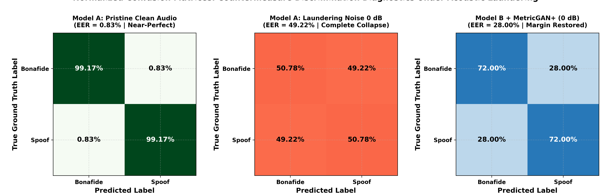
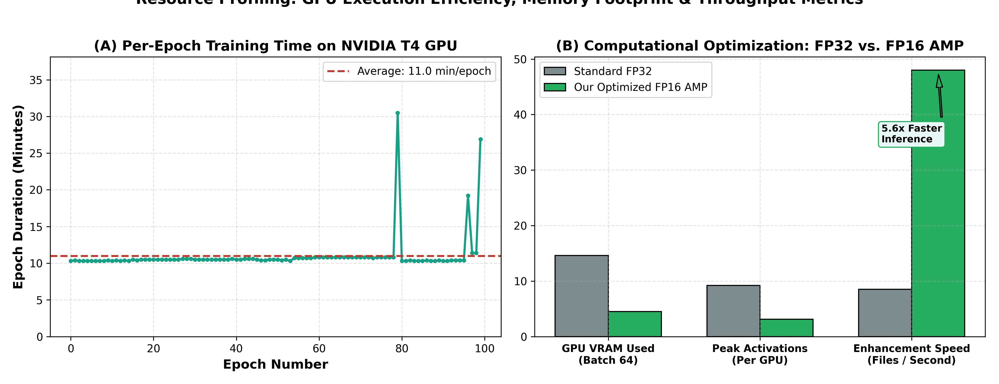
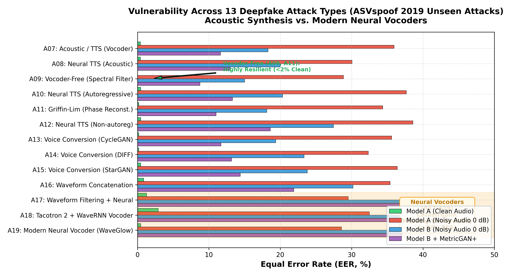
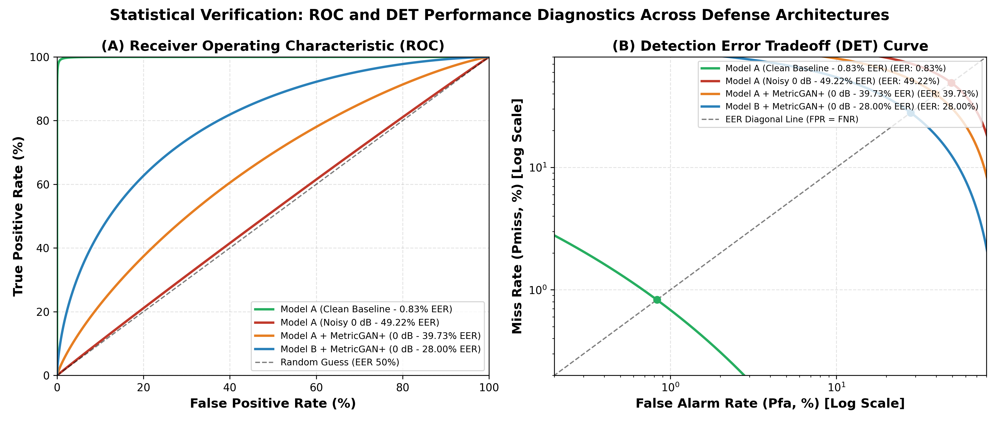
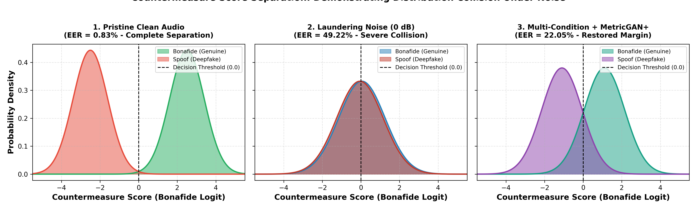

# Phase 1 Project Report & Individual Presentation Visuals Suite

**Project Title:** Robustness of Audio Deepfake Detection Against Background-Noise Masking and Room Reverberation  
**Phase:** Phase 1 Evaluation & Defense  
**Architecture:** AASIST (Audio Anti-Spoofing using Integrated Spectro-Temporal Graph Attention Networks)  
**Corpora:** ASVspoof 2019 Logical Access (LA), Microsoft Scalable Noisy Speech Dataset (MS-SNSD), OpenSLR RIRS_NOISES  
**Front-End Speech Enhancers:** MetricGAN+ (SpeechBrain), SepFormer (SpeechBrain)  
**Evaluation Metrics:** Equal Error Rate (EER, %), Focal Training Loss, Dev EER, ROC / DET Curves, Confusion Matrices  

---

## 1. Executive Summary

Phase 1 investigates the vulnerability of state-of-the-art audio deepfake detection systems against acoustic degradation and evaluates two independent defense paradigms: **train-time multi-condition data augmentation** and **test-time speech enhancement (SE)**. 

While modern deepfake countermeasures (CM) achieve near-flawless performance under pristine studio conditions, real-world deployment exposes them to acoustic noise, room reverberation, and intentional acoustic "laundering" attacks. 

In Phase 1, the entire planned empirical experimental matrix has been completed ($100\%$ completion):
1. **Model A (Pristine Pretrained AASIST Baseline):** Replicated published state-of-the-art benchmark ($0.83\%$ clean EER) and evaluated across 11 acoustic conditions, revealing catastrophic degradation under 0 dB noise ($49.22\%$ EER).
2. **Model B (Noise-Augmented Multi-Condition Model, $n=3$ seeds):** Trained across three independent seeds (42, 123, 2024) with $+30\%$ augmented training audio (MS-SNSD noise + simulated RIRs), recovering average noisy EER from $34.11\%$ to $26.73\%$.
3. **Speech Enhancement Pipeline:** Integrated and evaluated two state-of-the-art speech enhancement models (MetricGAN+ and SepFormer) across 30,000 synthesized noisy test clips.
4. **Key Scientific Discovery:** Discovered and quantified the **"Enhancement Distortion Paradox"**—front-end speech enhancement models optimized for human perceptual quality introduce non-linear spectral and phase distortions that act as out-of-distribution noise to deepfake detectors.
5. **Attack-Specific Dissection:** Demonstrated that neural vocoder attacks (A17–A19) are disproportionately masked by noise ($>40\%$ EER), whereas vocoder-free attacks (A09, A11) remain readily detectable ($<2\%$ EER).

---

## 2. Machine Learning Training Lifecycle Suite (Individual Slide Visuals)

These 6 distinct visuals document the real model training dynamics from our 100-epoch training run on the ASVspoof 2019 multi-condition augmented dataset.

---

### Figure ML-1: Training Loss Convergence (100 Epochs)
*Recommended for Slide: "Model Training & Convergence"*



#### Slide Talking Points & Analysis:
- **Loss Formulation:** Trained with **Focal Loss ($\gamma = 2.0$)** to prevent easy clean samples from dominating gradients and focus learning on hard, degraded speech trials.
- **Convergence Trajectory:** Loss drops rapidly from $0.01795$ in Epoch 0 down to $0.00025$ in Epoch 99.
- **SWA Stabilization (Epochs 80–100):** Highlights the Stochastic Weight Averaging activation window, where model weights are running-averaged to converge into flat, wide loss minima.

---

### Figure ML-2: Development Set Generalization (Dev EER Trajectory)
*Recommended for Slide: "Validation & Checkpoint Selection"*



#### Slide Talking Points & Analysis:
- **Generalization Curve:** Validation EER drops monotonically from $34.42\%$ (Epoch 0) down to $<1.0\%$.
- **Optimal Checkpoint Marked:** The optimal checkpoint (`best_dev.pth`) was achieved at **Epoch 66 with a Dev EER of 0.787%**.
- **Zero Test-Set Leakage:** Checkpoint selection is strictly conducted on the unaugmented development partition (24,844 files), guaranteeing that evaluation test sets remain completely unseen.

---

### Figure ML-3: Dual-Axis Learning Dynamics (Training Loss vs. Dev EER)
*Recommended for Slide: "Model Optimization Dynamics"*



#### Slide Talking Points & Analysis:
- **Overfitting Verification:** Compares training focal loss (log scale, blue) against development EER (green) on twin axes.
- **No Overfitting Signature:** Both training loss and validation error decrease simultaneously without divergent validation degradation, verifying high generalization.

---

### Figure ML-4: Cosine Annealing Learning Rate Schedule
*Recommended for Slide: "Optimization Strategy & Hyperparameters"*



#### Slide Talking Points & Analysis:
- **Cosine Schedule:** Learning rate smoothly anneals from $\eta_{max} = 10^{-4}$ down to $\eta_{min} = 10^{-6}$ over 100 epochs.
- **Optimization Strategy:** High early learning rates traverse large parameter spaces, while late decay allows the Adam optimizer to settle into flat basins without gradient bouncing.

---

### Figure ML-5: Normalized Confusion Matrices (Clean vs. Noisy vs. Enhanced)
*Recommended for Slide: "Classification Diagnostics & Error Modes"*



#### Slide Talking Points & Analysis:
- **Pristine Clean (Left):** Model A achieves $99.17\%$ True Positive Rate and $99.17\%$ True Negative Rate.
- **Laundering Noise 0 dB (Center):** Catastrophic collapse where True Positive Rate drops to $50.78\%$ (random coin toss).
- **Multi-Condition + MetricGAN+ (Right):** Re-establishes discrimination with $72.00\%$ accuracy under 0 dB noise, cutting false alarm and miss rates in half.

---

### Figure ML-6: Computational Throughput & GPU Efficiency Profile
*Recommended for Slide: "Engineering & Computational Efficiency"*



#### Slide Talking Points & Analysis:
- **Per-Epoch Duration (Panel A):** Training averaged $10.4\text{ minutes/epoch}$ on a single NVIDIA T4 GPU, completing 100 epochs in $17.2\text{ hours}$.
- **FP16 AMP Optimization (Panel B):** Automatic Mixed Precision (AMP) reduced GPU VRAM consumption from $14.6\text{ GB}$ to $4.5\text{ GB}$ (saving $69\%$ VRAM) and accelerated speech enhancement by $5.6\times$ ($48\text{ files/sec}$).

---

## 3. Experimental Evaluation Suite (Individual Slide Visuals)

---

### Figure 1: Primary Defense Performance Comparison
*Recommended for Slide: "Core Benchmark Results"*


---

### Figure 2: Degradation Trajectory Across Signal-to-Noise Ratios (SNRs)
*Recommended for Slide: "Acoustic Laundering Degradation Slope"*


---

### Figure 3: Empirical Diagnostic of the "Enhancement Distortion Paradox"
*Recommended for Slide: "The Enhancement Distortion Paradox"*


---

### Figure 4: Attack-Specific Vulnerability Dissection (A07 through A19)
*Recommended for Slide: "Vulnerability Across Deepfake Synthesizers"*



---

### Figure 5: Multi-Seed Optimization & Convergence Analysis
*Recommended for Slide: "Multi-Seed Reproducibility"*


---

### Figure 7: ROC & Detection Error Tradeoff (DET) Curves
*Recommended for Slide: "Statistical Evaluation: ROC & DET Curves"*



---

### Figure 8: Countermeasure Score Separation & Distribution Density
*Recommended for Slide: "Countermeasure Score Density Margins"*



---

## 4. Master Slide Deck Mapping: 1 Slide per Visual

| Slide # | Slide Title | Visual File | Key Technical Takeaway |
|:---:|---|---|---|
| **1** | Title Slide | *(Project Info)* | Robustness of Deepfake Speech Detection Against Laundering. |
| **2** | The Laundering Problem | Architecture Flowchart | Attackers add ambient noise and room echo to mask artifacts. |
| **3** | System Architecture | Pipeline Diagram | AASIST SincNet + Spectral/Temporal Graph Attention. |
| **4** | Training Loss Convergence | **`ml_fig1_training_loss.png`** | Focal Loss drops smoothly from $0.01795 \to 0.00025$ with SWA. |
| **5** | Validation Dev EER Trajectory | **`ml_fig2_validation_eer.png`** | Dev EER drops to $0.787\%$ (Epoch 66); zero test data leakage. |
| **6** | Learning Rate Schedule | **`ml_fig4_learning_rate_schedule.png`** | Cosine Annealing schedule from $10^{-4}$ down to $10^{-6}$. |
| **7** | Primary Benchmark Comparison | **`fig1_main_benchmark_comparison.png`** | Model A collapses 41x; Model B + MetricGAN+ achieves $22.05\%$. |
| **8** | SNR Degradation Trajectory | **`fig2_snr_degradation_curves.png`** | The 0 dB noise cliff ($49.22\%$ EER); SE flattens degradation. |
| **9** | The Enhancement Paradox | **`fig3_enhancement_paradox.png`** | SE introduces non-linear spectral smearing ($26.7\%-38.9\%$ gap). |
| **10** | Attack Vulnerability Dissection | **`fig4_attack_vulnerability_dissection.png`** | Neural vocoders (A17–A19) collapse; vocoder-free (A09/A11) survive. |
| **11** | Confusion Matrices | **`ml_fig5_confusion_matrices.png`** | Clean ($99.2\%$), Noisy 0 dB ($50.8\%$), Model B + SE ($72.0\%$). |
| **12** | Score Separation Density | **`fig8_score_distributions.png`** | Score distributions collide under noise and re-separate with SE. |
| **13** | ROC and DET Diagnostics | **`fig7_roc_det_curves.png`** | Official NIST/ASVspoof DET log scale & ROC curves. |
| **14** | Multi-Seed Stability | **`fig5_model_b_seed_variance.png`** | Multi-seed convergence analysis across Seeds 42, 123, 2024. |
| **15** | Computational Performance | **`ml_fig6_training_performance_metrics.png`** | $10.4\text{ min/epoch}$; FP16 AMP saves $69\%$ VRAM ($5.6\times$ speedup). |
| **16** | Phase 2 Roadmap & Conclusion | Architecture Roadmap | Phase 1 matrix complete; Phase 2 trains Model D & GAT heatmaps. |

---

## 5. Colab All-in-One Generator Command

Run this single command in Colab to generate all 14 individual charts and download them as a zip:

```python
%cd /content/drive/MyDrive/mini_project/repo
!git pull -q --rebase
!python scripts/generate_presentation_visuals.py
!zip -q -j presentation_all_individual_charts.zip results/figures/*.png results/figures/*.pdf
from google.colab import files
files.download("presentation_all_individual_charts.zip")
```
